# ISEA-Lab Reflection 1a-2
## Lab Objective
Objective was to go through linux GUI and commands
##Following the lab
In part 1, i had a little trouble with LibreOffice as i mixed up the LibreOffice Base (the database) with LibreOffice Writer which was the one needed to open a document, as that was what opened from the AppCenter

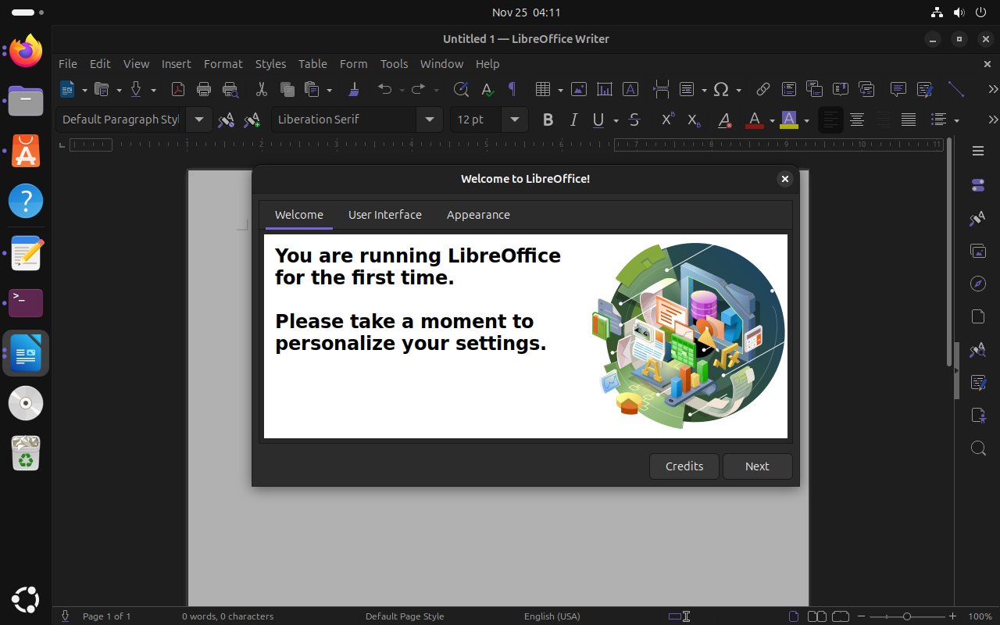

There was no problem checking the internet

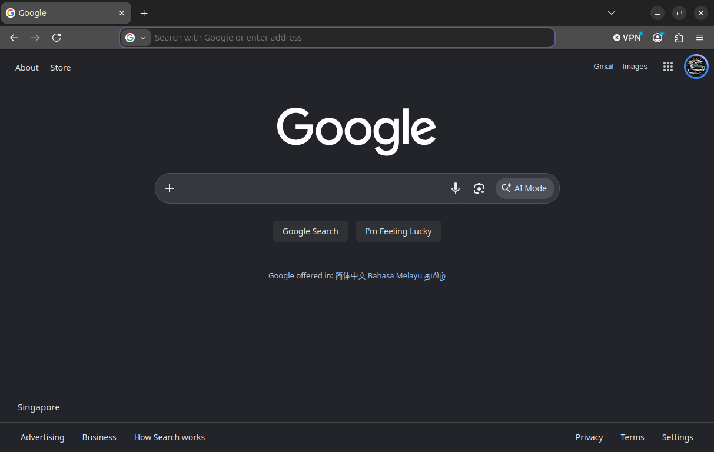

I then used the "touch ~/Documents/test_gui/live_demo.txt" command to create a txt file from the terminal that appeared in real time in the folder

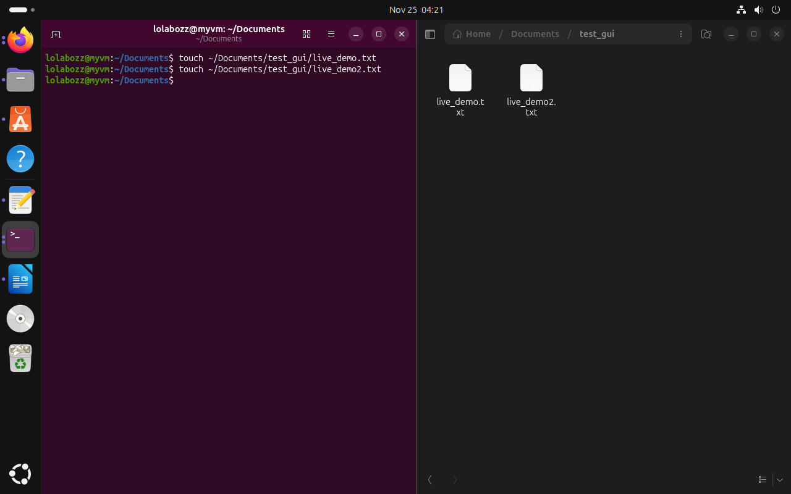

In part 2, followed the commands to monitor processes.
"ps -e"     - lists running processes
"top"       - live process mointoring. pressing 1 after shows CPU core

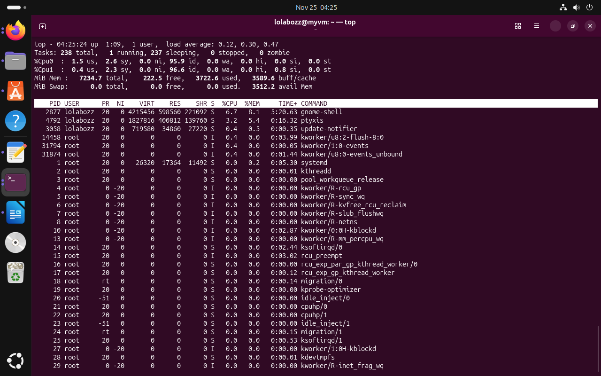

Then i used the different ls commands to list the files i had. From looking up the different meanings:
"ls"        - standard list
"la -la"    - All files including hidden (.) files
"ls -alt"   - Sorted by newest modification time
"ls -lah"   - Human-readable file sizes(KB/MB)

Also tried the commands
"nano"  - create file
"gedit" - edit file
"cat"   - print to terminal
"less"  - view file

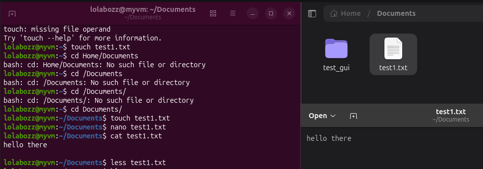

Next i used the functions on the testfile.txt i created, 
"cp"    - copy file
"mv"    - rename/move file
"rm"    - delete file

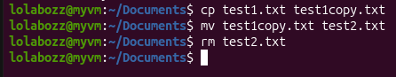

lastly, viewing the system info
"uname -a"      - Kernel version and architecture
"lsb_release -a"- Ubuntu distribution version
"hostnamectl"   - Hostname, OS, and virtualization details

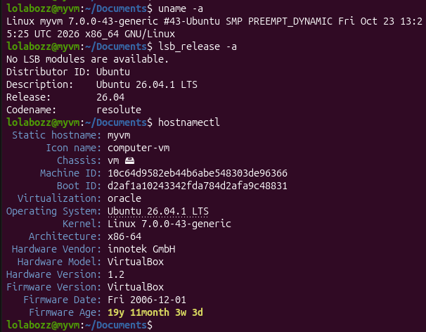

In part 3, I tried the "whoami" and "sudo whoami" commands, with "whoami" showing my account name, and "sudo whoami" showing root. sudo was then needed to add a user and delete the user after. Sudo seems to be the keyword for admin actions.

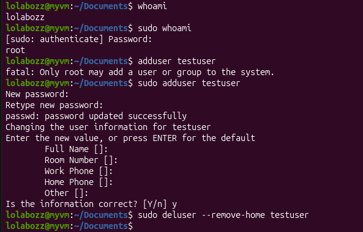

Part 4 had me identifying my local ip address and pinging google's dns server 8.8.8.8

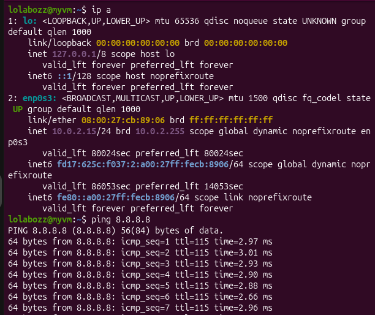

followed by creating a custom alias for the previous GoogleDNS

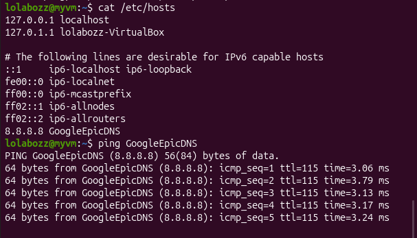

"nslookup" and "whois" showed the addresses and domains for the website.

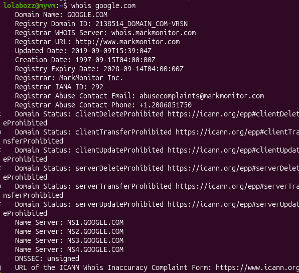

comparing my public and private ip, my private ip shown though "ip a" was 10.0.2.15 which is the VM in the local virtual network. However, the website is able to see my public ip from my router/ISP.

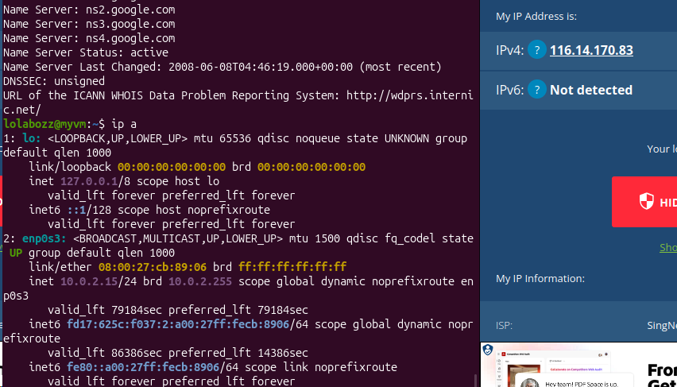

Part 5's commands showed the hardware specs

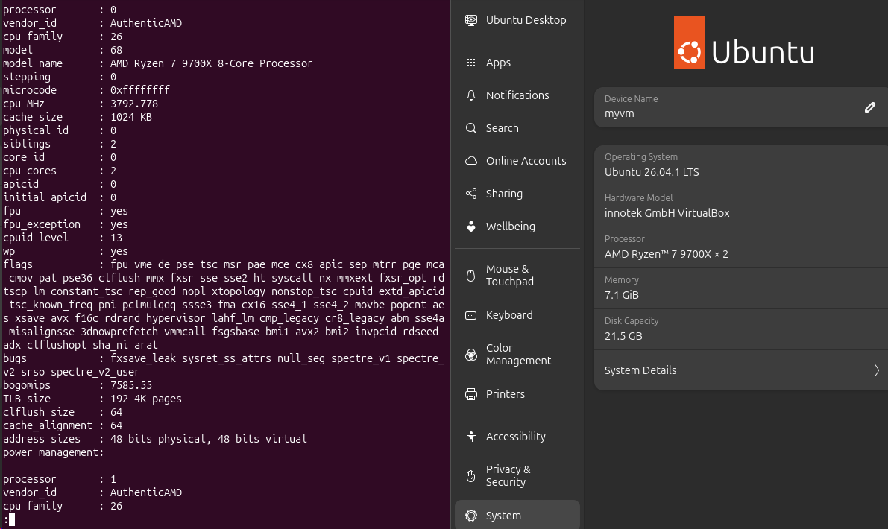

Part 6 was about installing and updating software.

##Reflection

Using CLI has made me understand the type of OS linux is more. There are many commands to be able to do a large variety of things, and i believe that if someone knew the system well, they could have a higher level of customization than other OS like windows. Although not using the common GUI is less intuitive, for server management, i can understand the need for CLI instead, to prevent unnecessary bloat.
