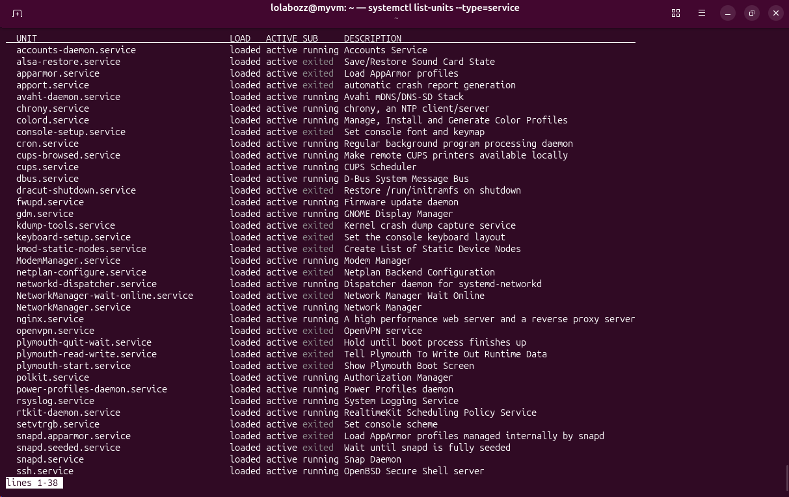
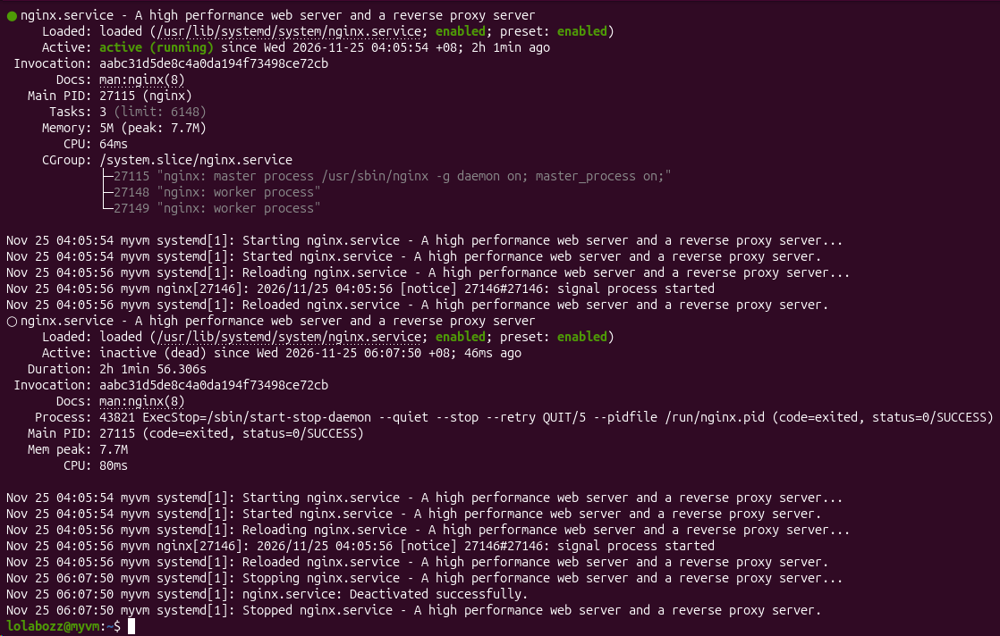
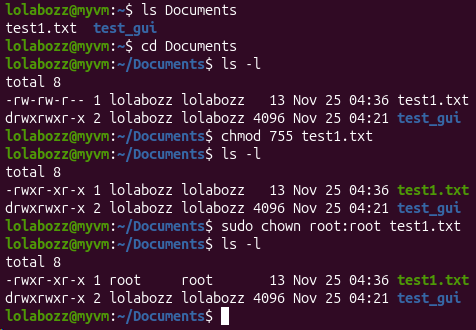
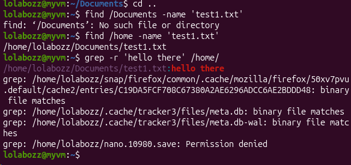

# ISEA-Lab Reflection 1b
## Lab Objective
Objective was to understand and manage background services, explore and apply file and directory premissions, and use commands like 'find' and 'grep'
##Following the lab

Used the "systemctl list-units --type=service" command to list services

Originally i had installed ubuntu, but i swapped to nginx, so i performed the start/stop services with nginx instead. 

Next i performed a permissions exercise with a .txt file, using "ls -l" to check the changes each time.

I then used the 'find' and 'grep' commands to search for the test1.txt file i had been using. Found that 'find' had to be used from home for the search to work. It was also interesting that grep searched for the contents within the files.

