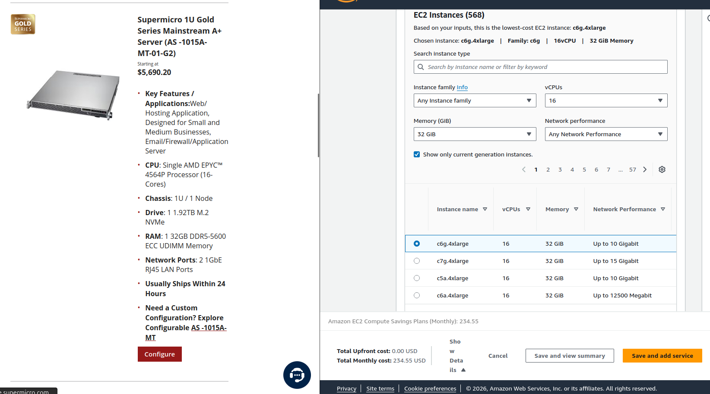
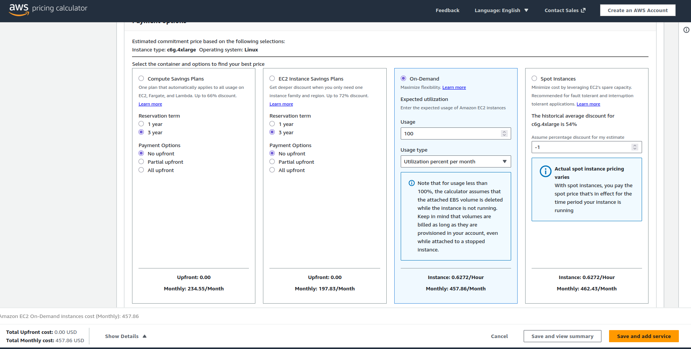

# ISEA-Lab Reflection 2a
## Lab Objective
Objective was to apply TCO concepts in practical comparisons

##Following the lab
Instead of following the printer lab, I tried performing it with a physical server vs a cloud based server.
After searching online, these were the products i chose to compare. I matched the compute and RAM of 16cores/vCPUs and 32GB/GiB of memory.

Pricing for cloud aws as shown:

A 3 year baseline cost comparison was made with the following results:

| Cost Component | On-Premise: Supermicro AS-1015A-MT-01-G2 | Cloud: AWS `c6g.4xlarge` (3-Yr Compute Savings Plan) | Cloud: AWS `c6g.4xlarge` (On-Demand, 100% Util.) |
| :--- | :--- | :--- | :--- |
| **Upfront Cost (CapEx)** | **$5,690.20** | **$0.00** | **$0.00** |
| **Monthly Recurring (OpEx)** | $0.00 *(hardware)* | **$234.55 / mo** | **$457.86 / mo** (`$0.6272/hr`) |
| **Year 1 Total** | $5,690.20 | $2,814.60 | $5,494.32 |
| **Year 2 Total (Cumulative)** | $5,690.20 | $5,629.20 | $10,988.64 |
| **Year 3 Total (Cumulative)** | **$5,690.20** | **$8,443.80** | **$16,482.96** |
| **Included Storage** | 1.92 TB M.2 NVMe | EBS-only *(billed separately)* | EBS-only *(billed separately)* |

As seen from the table, by year 1, the 100% util on demand payment would have almost broken even. By year 2, the cloud based service with the 3 year compute savings plan starts to break even as well. By year 3, the On demand pricing would have cost more than the physical server by almost 3 times as much, while the 3 years compute saving plan costs about 50% more.

The cloud services also have further add on costs as they are EBS-only. To match the physical server's 1.92TB storage, there would be a even higher recurring monthly fee added on, along side other costs.

However, this does not take into account the physical server's continuous costs such as electricty cost, server space and network infrastructure. Hardware maintenance and patching are also excluded from the costs.

For better cost effectiveness and if physical facility infrastructure and IT staff already exists, purchasing the physical Supermicro server saves costs after year 2. 
However, for rapid deployment without upfront capital spending, or organisations without the ability to support physical facilities, the cloud AWS server on the compute savings plan removes the need for hardware maintenance and maintains operational agility.
