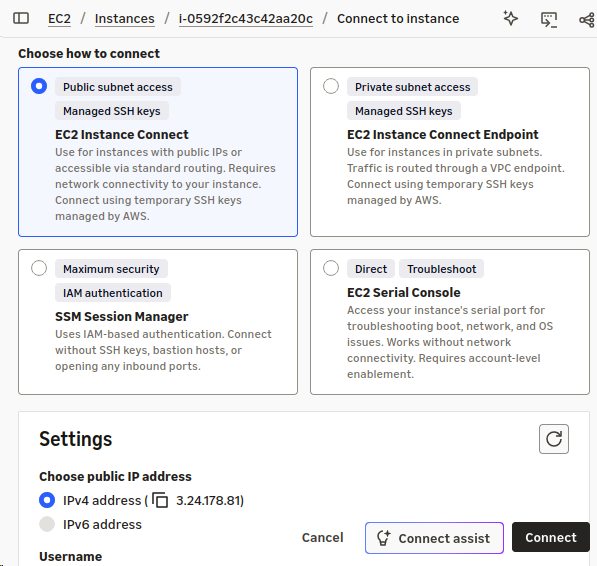
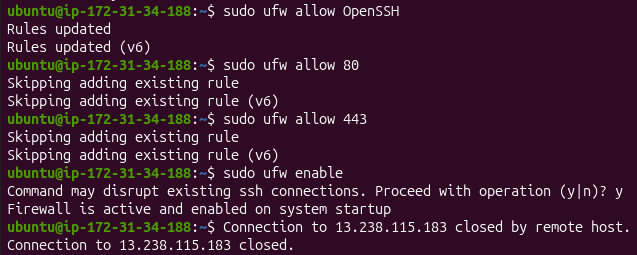
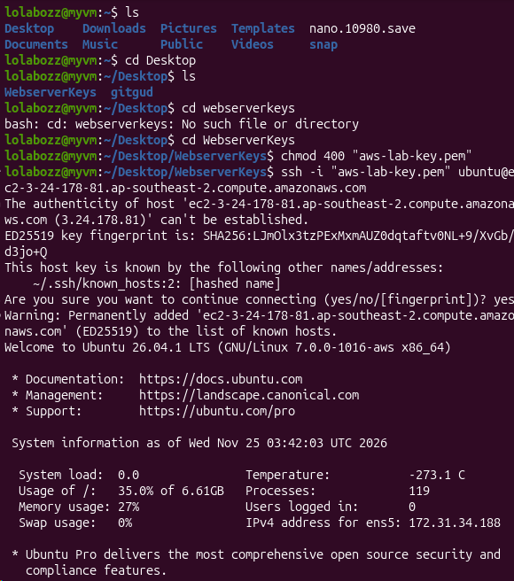
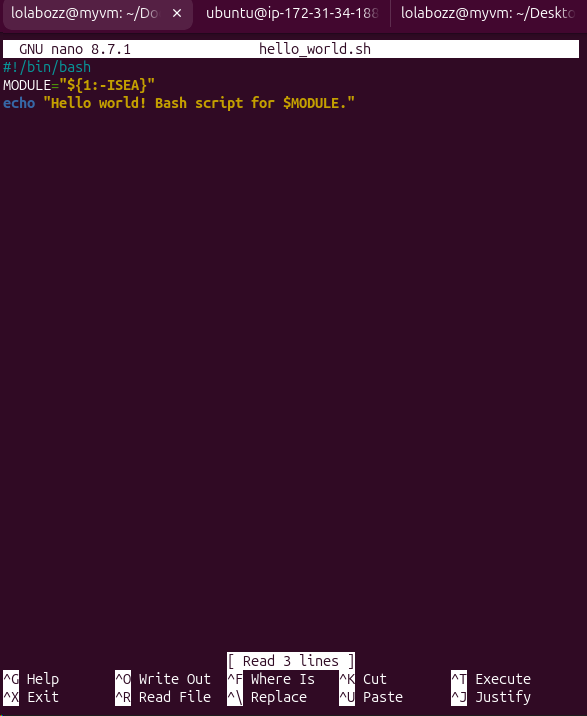
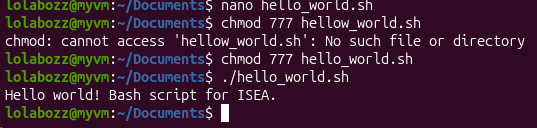
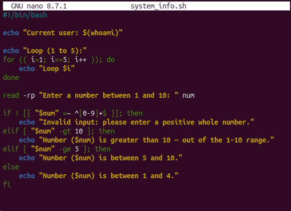
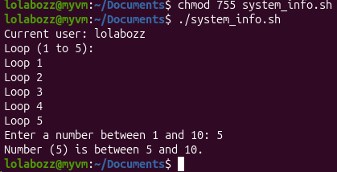
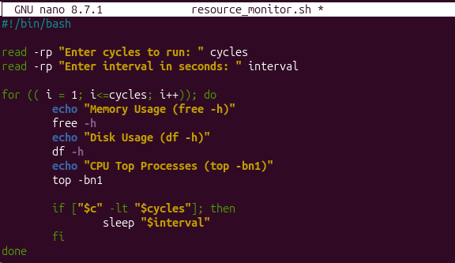
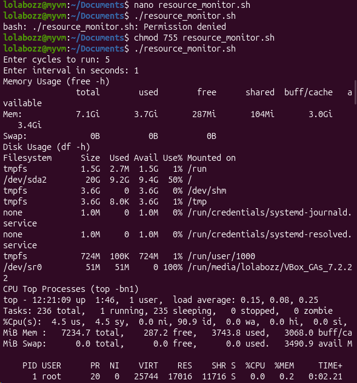

# ISEA-Lab Reflection 2b
## Lab Objective
Objective was to Launch and configure EC2 instance, and some bash scripting

##Reflection
While performing this exercise, i kept running into different problems.
At first, while following the lab, AWS was giving me issues signing in. When i finally managed to get the proper EC2 page, i continued to follow the steps in the lab to get the EC2 instance running which worked at first, however i was unable to connect through the EC2 instance connect button that was available on the AWS webpage.

As i was trying and failing to connect to the server, i continued onto different steps and labs which was a mistake (will talk about it later).

When i came back to it later, i managed to get access through EC2 instance connect by opening my SSH port22 to everyone (0.0.0.0/0) (important clue for why there was an error). Afterwards, i managed to setup the server and perform the lab3a actions until i got the https certificate, before i was locked out of the server again.

This time, I had apparently missed the line to allow OpenSSH (port22) through before turning on the firewall, so i was totally locked out.
After searching up for how to diagnose the issue, i had to turn off the server, enter a script on startup for the server to turn off the firewall on startup to be able to access the server again.

At this point, i had also managed to access the server from my VM instead of the EC2 instance connect which solved my previous problem of only being able to access it when my server SSH was open to all. The ip that the EC2 instance connect connects from is not the same as the my-ip that was allowed through port22, causing me to be locked out everytime i tried to go in. Once i figured out this issue, i closed back my port22 to my ip only.

Next, i moved onto the bash scripting exercise. The first was a print of "hello world". I tried adding a variable within the echo statement as well to try it out. 
"chmod 777" grants read, write and executable rights to every user on the system.
"#!/bin/bash" tells the OS kernel which interpreter should execute the script and behave consistently.

Then i did the Loop and conditionals exercise. Having other coding knowledge made this portion simpler as the logic is pretty much the same, just with different syntax. Also performed standard error handling.

Lastly i did the resource monitoring script.

This list helped while creating all the bash scripts

Common integer comparison operators in Bash:
-lt: less than (<)
-le: less than or equal to (<=)
-gt: greater than (>)
-ge: greater than or equal to (>=)
-eq: equal to (==)
-ne: not equal to (!=)

