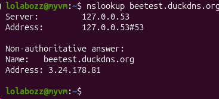
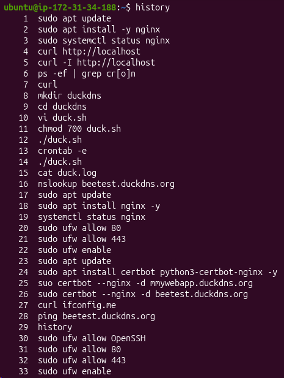
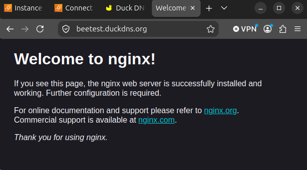
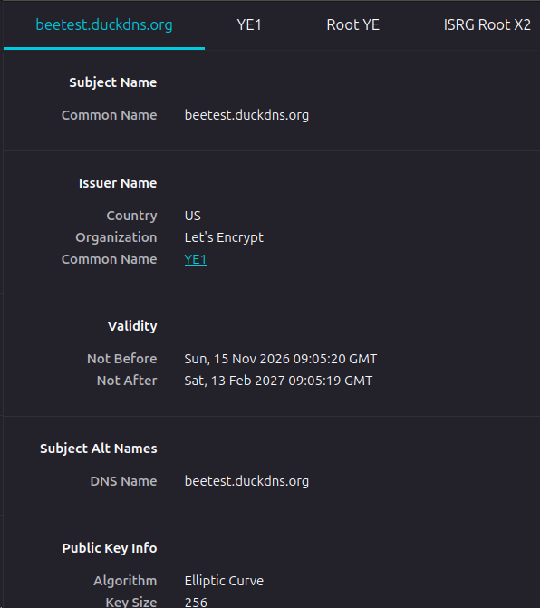
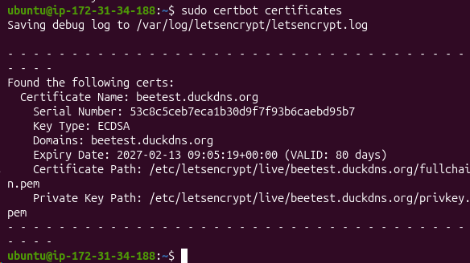
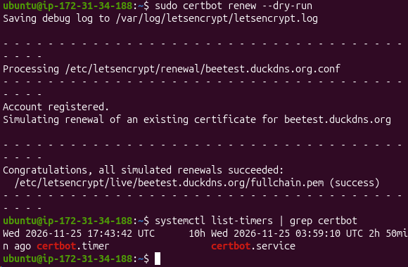

# ISEA-Lab Reflection 3a
## Lab Objective
Objective was to Configure and test DNS using a cloud provider

##Reflection

Following from the previous lab, as i had jumped ahead without setting up my web server, i had problems later down the line while doing this lab. Namely, hosting the web page on my VM instead of the web server. This caused me to be stuck for awhile as well after when the web page ip kept changing back to my router ip instead of the web server ip, since i had installed the DNS on my VM instead of the web server.

Moving on from that hiccup, I had used DuckDNS to register a domain. I then followed the steps for installation (As mentioned, unfortunately onto my VM instead of the web server at first). Once i had done it properly, i found no issues with the other steps.

History showing the failure to open port 22 and running certbot

Looking up the certificate details, shows expiry in 3 months

I also ran a dry run of the certbot renewal

