# ISEA-Lab Reflection 3b
## Lab Objective
Objective was to introduces Bash scripting for creating file backups, scheduling them using cron jobs, and exporting them to the cloud.

##Reflection

Started with testing commands within bash itself

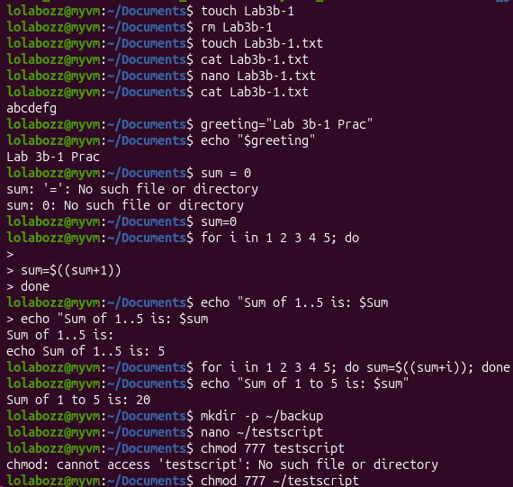

followed by making a bash script to copy the contents of /Documents to /backup. There was a little fumble here as i was following the directory "/home/ubuntu/Documents" when i should have been coding it to "/home/lolabozz/Documents" instead (aka my linux username).

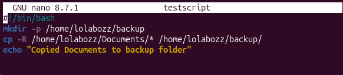

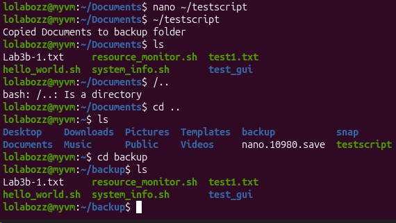

Once i had figured that out, i created another script without the hardcoded directories which had performed the same way.

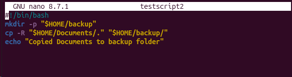

I then used bash to move testscript to the usr/bin/ and ran it again.

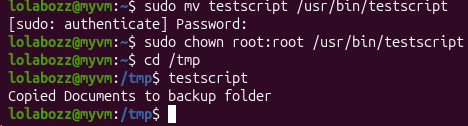

Then i added the date function for the filename and the zip function

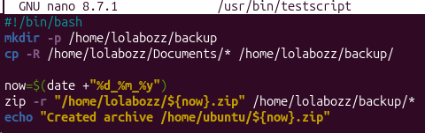
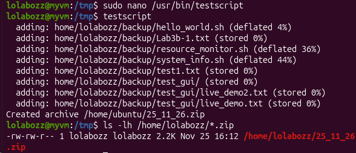

Afterwards i edited cron to schedule the backup at every 10th minute of the hour. 

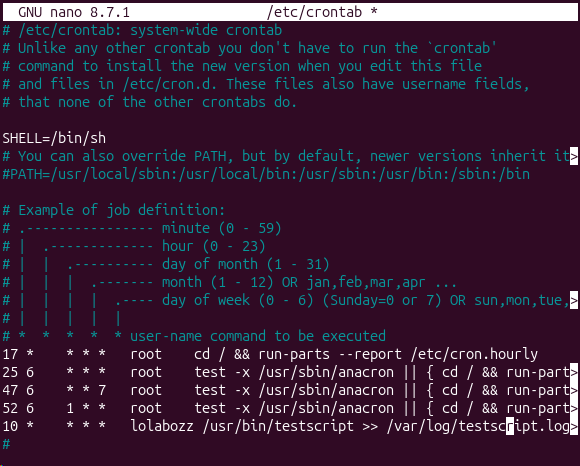

I then used key-based SSH access to access and upload the .zip file onto the cloud instance.
I had to edit the testscript again to add the keypath to the cloudIP with "/usr/bin/scp -i /home/lolabozz/Desktop/webserverkeys/aws-lab-key.pem "/home/lolabozz/${now}.zip" "ubuntu@3.24.178.81:/home/ubuntu/""

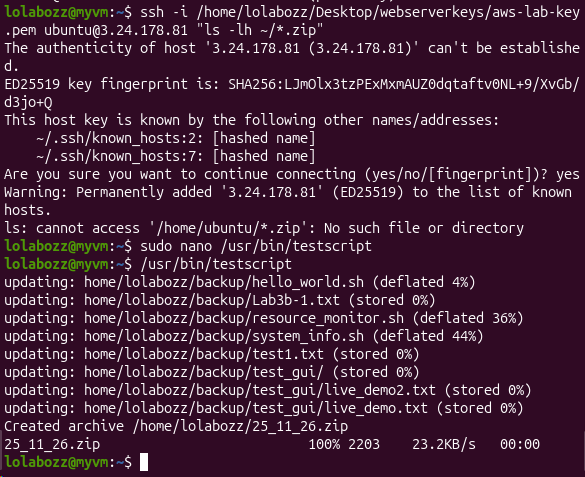
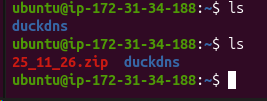

However i realsied that this hardcoded ip would cause issues whenever i rebooted the AWS and it changed ip. So i changed the "ubuntu@3.24.178.81:/home/ubuntu/" into "ubuntu@beetest.duckdns.org:/home/ubuntu/" since my duckdns webpage already constantly updates itself with the AWS ip.

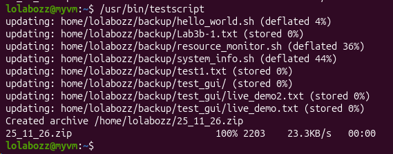

I deleted the zip file within the cloud to ensure that i was uploading the file again when i ran the updated script.

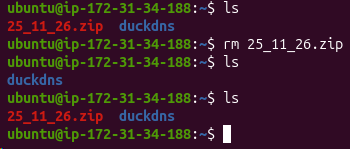
