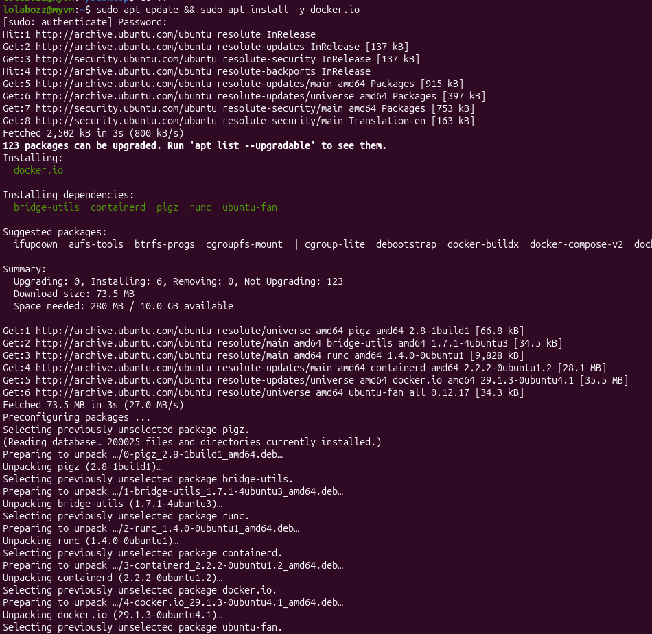
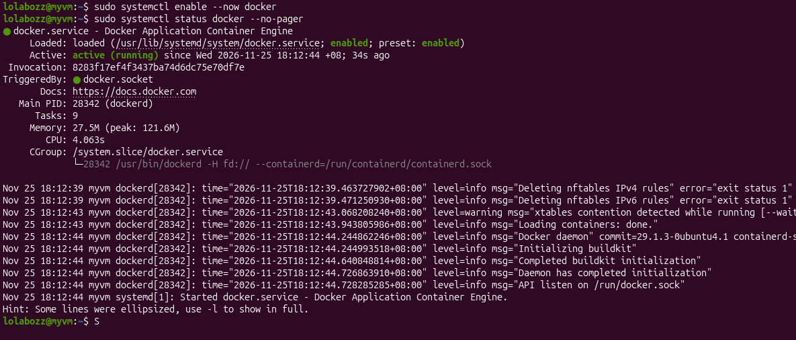
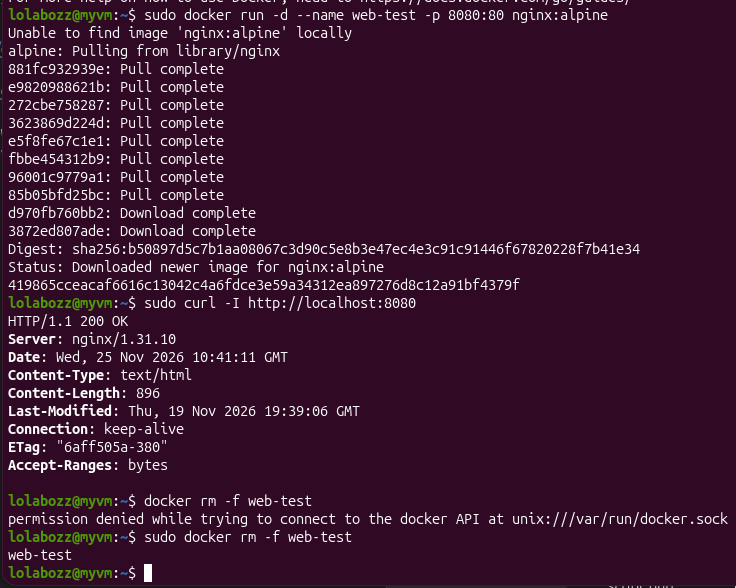
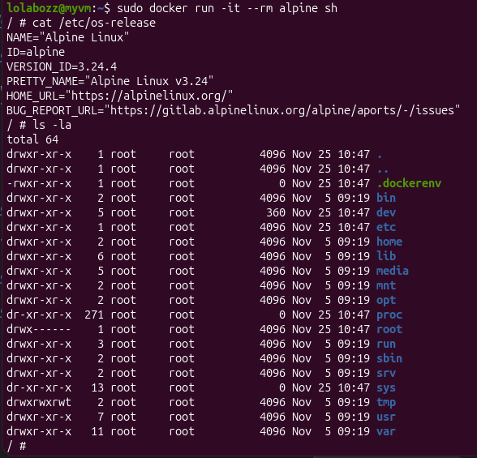
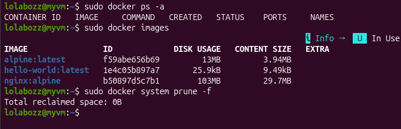

# ISEA-Lab Reflection 4
## Lab Objective
Objective is to explore one additional server service

##Reflection

For the additional server service, i decided to use Docker

From my understanding, docker is a way to build and run containers; Containers being a stripped down version of a virtual machine that act as the smallest possible version of the software.

The commands below were to set up a temporary web server on a custom port, test it, then remove it.

Next i went into a minimal Linux environment, printed the os-release and listed all the files with "ls -la"

I then listed the containers and images i've downloaded and pruned any unused Docker data to free back the disk space.

